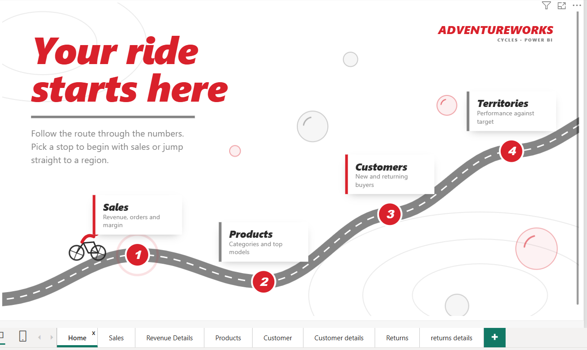
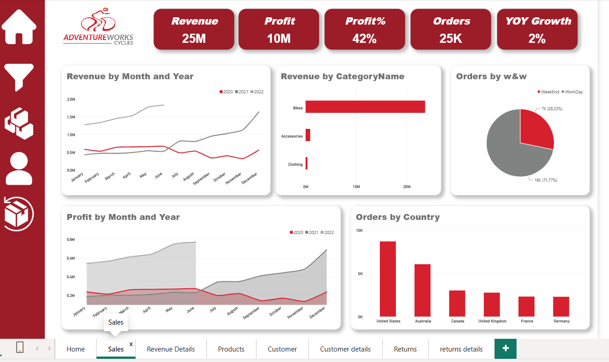
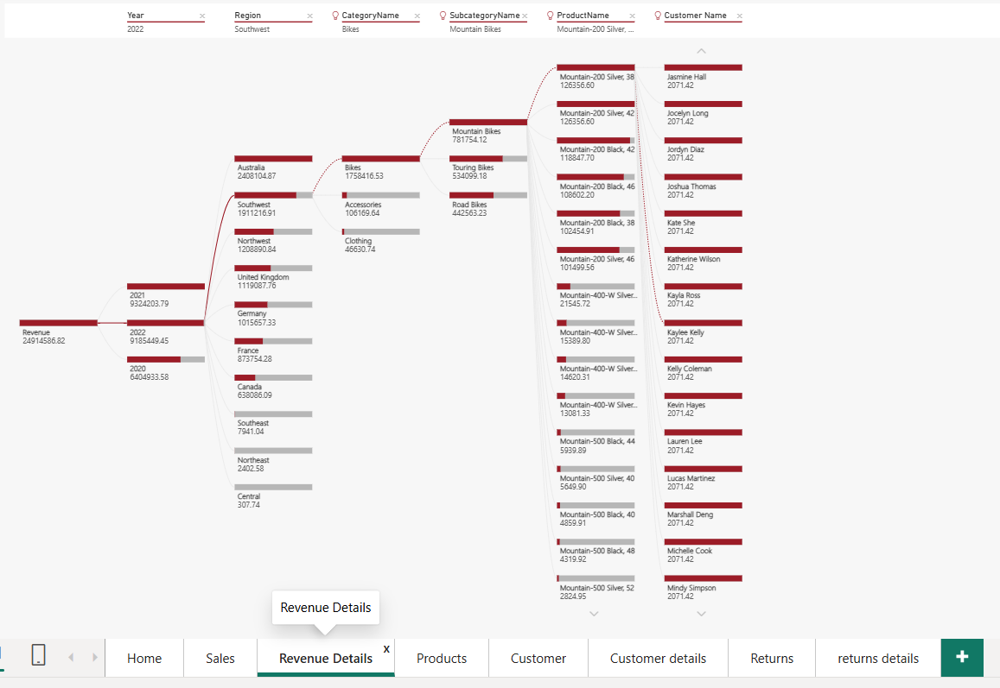
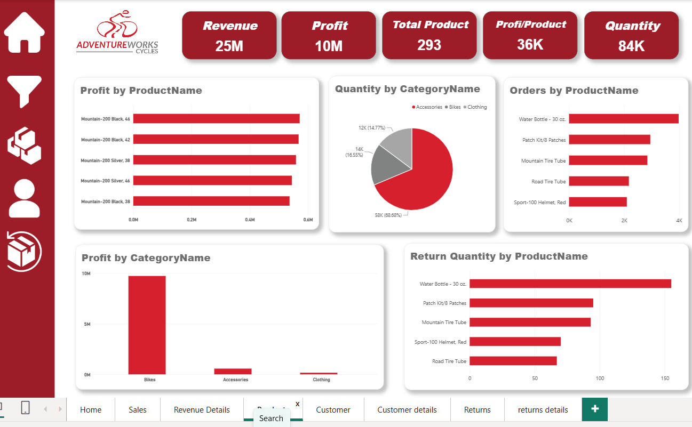
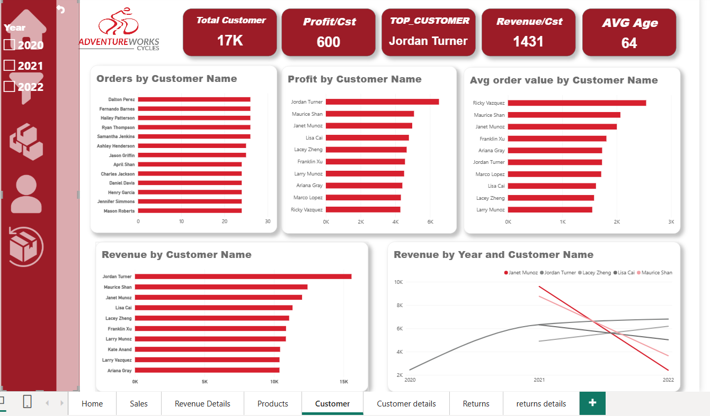
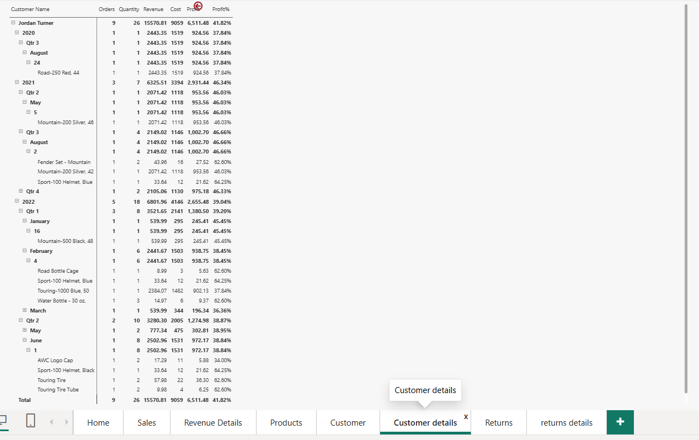
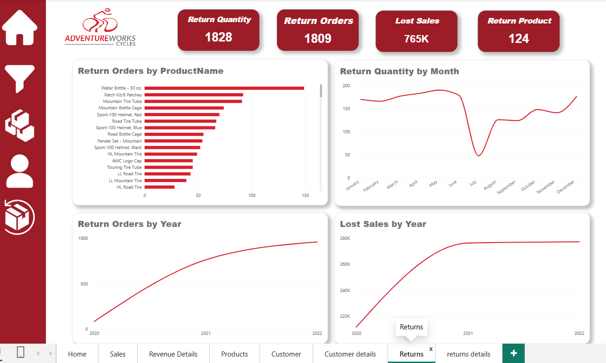
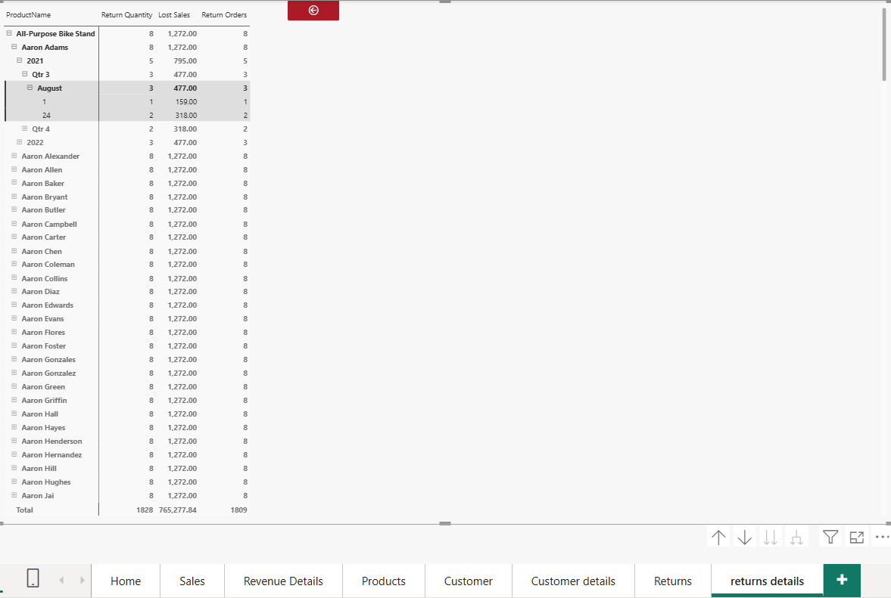

# AdventureWorks Cycles – Power BI Analysis

## Project Overview

An interactive Power BI project analyzing AdventureWorks Cycles' sales, product performance, customer behavior, and returns.

The goal is to evaluate business performance, identify trends, and generate actionable insights to support data-driven decision-making.

## Dashboard Pages

The dashboard includes eight interactive pages:

| Page | Focus |
|---|---|
| Home | Dashboard navigation |
| Sales | Revenue, profit, orders, and geographic performance |
| Revenue Details | Revenue drill-down analysis |
| Products | Product sales, quantity, and profitability |
| Customer | Customer contribution and behavior |
| Customer Details | Detailed customer analysis |
| Returns | Return performance and lost sales |
| Returns Details | Product-level return analysis |

## Key Business Insights

- **Sales Performance:** Bikes generated the highest revenue and profit, while Accessories led in quantity sold.
- **Market Performance:** The United States led in revenue, profit, and orders, while Australia had the highest average order value.
- **Customer Analysis:** Jordan Turner was the top revenue-contributing customer overall, although the leading customer varied by year.
- **Product Performance:** Mountain-200 Black, 46 led in revenue and profit, while Sport-100 Helmet Red recorded the highest lost sales.
- **Returns Analysis:** Return quantity and lost sales increased from 2020 to 2022, with 2022 recording the highest values across the return metrics analyzed.

## Tools & Skills

- Power BI
- Power Query
- DAX
- Data Modeling
- Data Cleaning & Transformation
- Data Visualization
- Business Analysis

## Data Limitations

The 2022 dataset covers only six months (January–June), so comparisons with full-year periods should be interpreted carefully.

## Detailed Analysis

For the complete findings and business insights, see [Key Business Findings & Insights](Documentation/Key_Findings.md).

## Project Screenshots

### Home

### Sales

### Revenue Details

### Products

### Customer

### Customer Details

### Returns

### Returns Details

## Conclusion

This project demonstrates the use of Power BI to transform business data into interactive dashboards, identify performance trends, and uncover insights that support business decision-making.
